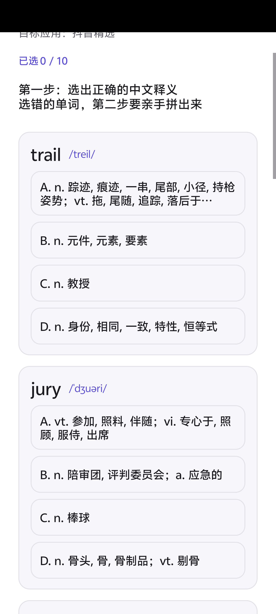
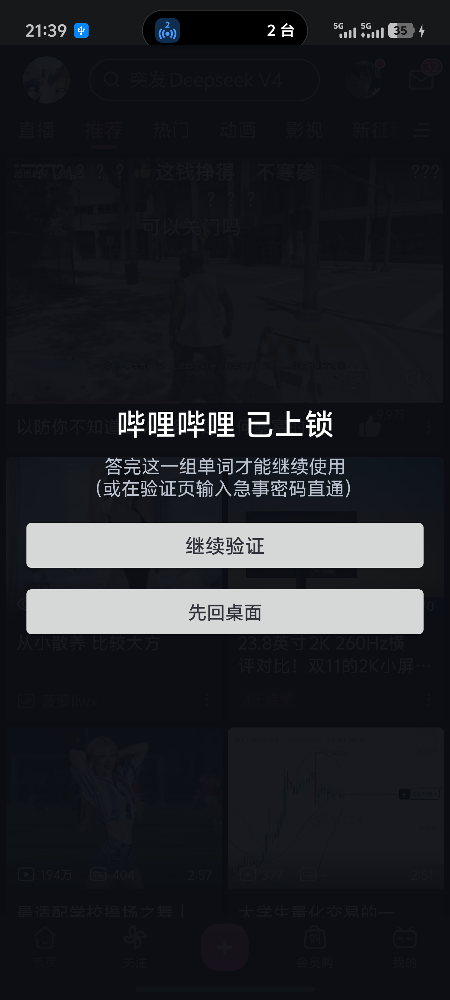
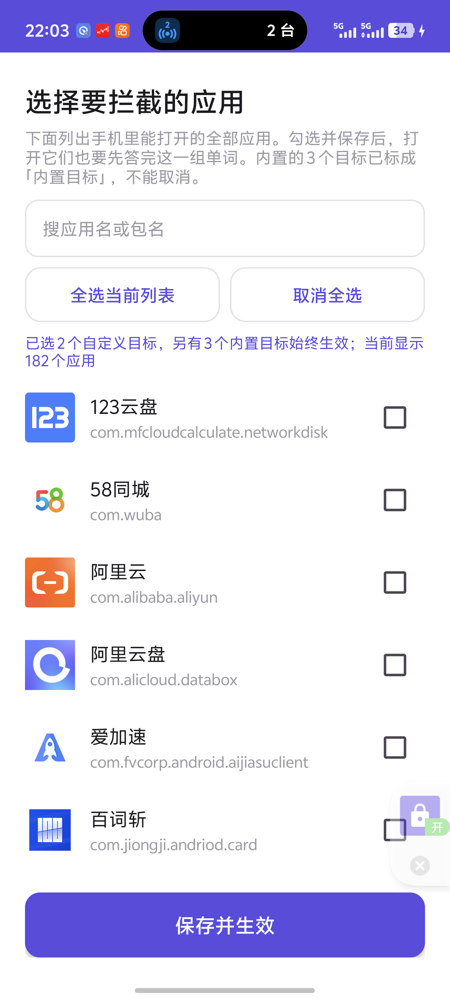
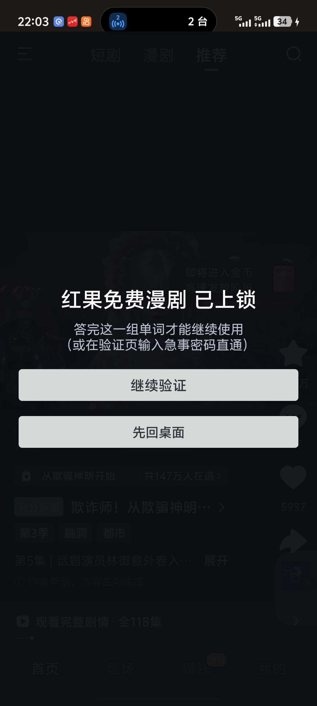
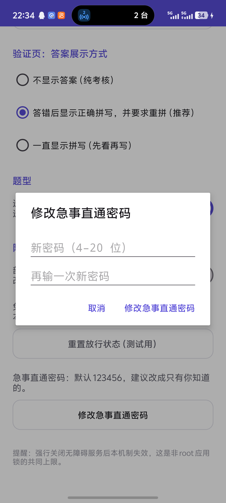
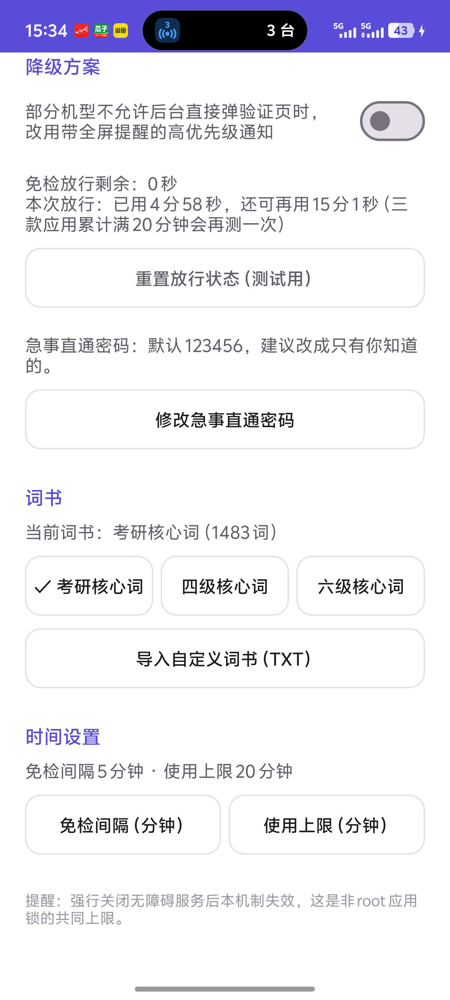
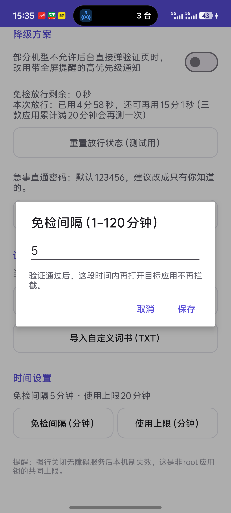

# 拼写自律锁（SpellLock）

一个**纯手机本地运行**的「多巴胺戒断」工具：打开哔哩哔哩 / 抖音 / 抖音精选时，立刻用全屏验证页覆盖，
必须答对 **10 个单词** 才放行（选择题模式：英文选中文，选错的再拼写；拼写模式：直接拼写）。没有跳过按钮。

- **三本内置词书可切换**：考研核心词 1483 / 四级核心词 1616 / 六级核心词 2143（口径见 §4）
- **可导入自定义词书**：TXT，每行 `单词|中文释义|巧记`，至少 10 个词，导入后自动切过去（§13.2）
- **免检间隔与使用上限都能自己调**：默认「验证通过后 5 分钟免检 + 目标应用累计 20 分钟再测一次」，范围 1–120 / 1–480 分钟（§13.3）
- 出过的词 **5 天内不重复**；答错揭晓答案时，词书里带「巧记」就一并显示
- 急事直通：验证页底部输入密码可直接放行，**默认密码 123456**，可在主页「修改急事直通密码」改成自己的

> 本 README 以 **v1.1.0（2026-11-24）** 为准；§11 里的 v1.0.0 真机验证记录保留原文，作为当时的证据。

- 运行时**不依赖电脑端 ADB / Agent**，不 root，不用设备管理员，不用悬浮窗做主方案
- 主方案：`AccessibilityService` 监听 `TYPE_WINDOW_STATE_CHANGED`
- 只做「感知目标 App 到前台 → 立刻启动自己的全屏验证 Activity 覆盖上去」，不试图拦截系统启动
- 目标 App 一直在下层正常运行，验证通过只关闭验证页，目标 App 原样显现，**不重新启动目标 App**

---

## 1. 文件树

```text
spelllock/
├─ settings.gradle.kts
├─ build.gradle.kts
├─ gradle.properties
├─ gradlew / gradlew.bat
├─ gradle/wrapper/gradle-wrapper.{jar,properties}
├─ local.properties.example      （本地 SDK 路径示例，实际 local.properties 不要提交）
├─ tools/
│  └─ validate_words.py          词表校验脚本
├─ README.md
└─ app/
   ├─ build.gradle.kts
   ├─ proguard-rules.pro
   └─ src/main/
      ├─ AndroidManifest.xml
      ├─ assets/
      │  └─ books/               三本内置词书，每行：单词|/IPA/|中文释义|巧记（巧记可空）
      │     ├─ kaoyan.txt        考研核心词 1483 词（PDF 精选 600 ∪ 懒笔记考研高频 883）
      │     ├─ cet4.txt          四级核心词 1616 词
      │     └─ cet6.txt          六级核心词 2143 词
      ├─ java/com/detox/spelllock/
      │  ├─ SpellLockApp.kt            Application，建通知渠道
      │  ├─ MainActivity.kt            主页：状态 / 权限 / 包名检测 / 降级开关
      │  ├─ TargetApps.kt              ★ 目标应用集中配置（多包名列表）
      │  ├─ AppAccessibilityService.kt ★ 无障碍监听 + 过滤 + 启动验证页
      │  ├─ SpellCheckActivity.kt      ★ 全屏验证页：禁返回、选择题/拼写、放行
      │  ├─ SelfGuard.kt               验证页可见性标记（防重复弹）
      │  ├─ UnlockGate.kt              免检间隔 + 累计使用上限（主页可调 1–120 / 1–480 分钟）
      │  ├─ ForegroundFilter.kt        自身/SystemUI/桌面/输入法/电话过滤
      │  ├─ WordRepository.kt          词书加载/切换/导入、词数校验、抽 10 词（5 天去重）
      │  ├─ BlockNotifier.kt           降级方案：高优先级通知
      │  └─ AppPrefs.kt                降级模式 / 选择题模式 / 管理员密码
      └─ res/
         ├─ layout/activity_main.xml
         ├─ layout/activity_spell_check.xml
         ├─ layout/item_word_input.xml
         ├─ xml/accessibility_config.xml   ★ 声明 typeWindowStateChanged
         ├─ values/{strings,colors,themes}.xml
         ├─ drawable/…
         └─ mipmap-anydpi-v26/ic_launcher*.xml
```

---

## 2. 实现步骤（代码怎么跑起来的）

1. **无障碍服务收到事件**
   `AppAccessibilityService.onAccessibilityEvent()` 只处理 `TYPE_WINDOW_STATE_CHANGED`，取 `event.packageName`。

2. **命中目标应用**
   `TargetApps.isTarget(packageName)`，包名列表在 `TargetApps.kt` 的 `apps` 里集中维护，支持任意多个。

3. **过滤**
   `ForegroundFilter.shouldIgnore()` 忽略：自己的包名、SystemUI、android、电话/来电界面、
   包安装器、权限控制器、Launcher（`CATEGORY_HOME` 动态查询）、输入法（`enabledInputMethodList`）。
   这一步保证验证页不会因为自己的包名再次触发，不会闪屏或死循环。

4. **宽限期**
   `UnlockGate.isInGracePeriod()`：验证通过后 **免检间隔**（默认 5 分钟，主页可调 1–120 分钟，存 `AppPrefs.graceMinutes`）内不重复弹，避免在目标 App 内切页面时反复触发。
   计时用 `SystemClock.elapsedRealtime()`（改系统时间绕不过，重启后自动失效）。

   **累计使用时长**：`AppPrefs.usageMinutes`（默认 20 分钟，主页可调 1–480 分钟）。服务只在目标应用处于前台时计时
   （每 15 秒结算一次，验证页自己的答题时间不计），三款应用合计满该额度立刻重新上锁。验证通过后计数清零。

5. **启动 `SpellCheckActivity`**
   `FLAG_ACTIVITY_NEW_TASK + CLEAR_TOP + SINGLE_TOP`，Activity 声明
   `excludeFromRecents=true`、`taskAffinity=""`、`launchMode=singleTask`，独占任务栈。

6. **验证页**
   - 隐藏状态栏/导航栏（沉浸式），`onBackPressed` 空实现 + `OnBackPressedCallback` 空实现 + `onKeyDown` 吞掉 BACK
   - 没有跳过按钮
   - `WordRepository.draw()` 从**当前词书**抽 10 个词，**5 天内出现过的词优先排除**（不够用时退回全量）
   - 点右侧音标胶囊（`/ˈɡriːnhaʊs/ 🔊`）用系统 TTS 朗读该单词，帮助回忆拼写

7. **拼写校验 + 答案展示模式**
   `trim()` 后转小写比较（忽略大小写）。答错后按主页设置处理（默认「答错后显示」）：
   - **不显示答案**：只提示「拼写错误，请重试」，纯考核
   - **答错后显示（默认）**：显示「正确拼写：xxx」，清空该题输入，让你**再次拼写**；拼对才计数
   - **一直显示**：一开始就把 10 个正确拼写摆出来，先看再写；**用户一动手输入，该题正确答案立即消失**（防止照着抄）

   不论哪种模式，都必须全部答对才放行；答案展示只是辅助记忆，不提供任何跳过入口。
   选择题模式下：全对直接放行；有错则错词进入第二步拼写。

8. **放行**
   全部答对 → `UnlockGate.grant()` 记录时间戳并把累计使用时长清零 → `finishAndRemoveTask()`。
   目标 App 一直在下面，直接原样显现，**没有重新启动它**。

9. **词表异常时不得放行**
   `WordRepository` 会做两级校验（见第 4 节），任何异常都抛 `WordLoadException`，
   验证页进入「词表异常」状态：没有输入框、没有验证按钮，只有「重新加载词表」和「回到桌面（不解除限制）」。

10. **降级方案**
    部分 ROM 禁止后台启动 Activity：系统可能抛异常，也可能**静默拒绝**（不抛异常但页面不出现）。
    服务在 4.5 秒后检查验证页是否真的创建（`SelfGuard.lastShownAtElapsed`）；没创建就**保持遮罩上锁**并发一条**高优先级通知**：
    - 通知带 `setFullScreenIntent`：系统允许时由系统直接拉起验证页（系统发起，不受后台启动限制）
    - 不允许全屏 Intent（如 Android 14+ 未授权）时，用户点通知进入验证页；`PendingIntent` 同样由系统发起
    主页的「降级方案」开关可以强制一直走通知。

---

## 3. 「抖音精选」包名确认（已完成 ✅）

**实测结论（2026-11-23，目标设备 V2426A）：**

```text
抖音        com.ss.android.ugc.aweme
抖音精选    com.ss.android.yumme.video   ← 已写入 TargetApps.kt
哔哩哔哩    tv.danmaku.bili
```

- 应用名核对：系统应用列表里「抖音精选 · com.ss.android.yumme.video」
- 安装核对：`adb shell pm path com.ss.android.yumme.video` 返回
  `package:/data/app/.../com.ss.android.yumme.video-.../base.apk`
- 注意：`grep -i aweme` **扫不到**抖音精选（它的包名不含 aweme），所以只靠 aweme 关键字会漏。

**不猜包名。** 抖音精选和抖音、抖音极速版是三个不同的包。以后换机/重装，按下面的方式重新确认。

### 方式 A：电脑 ADB（只用来确认包名，不是运行时依赖）

```bash
adb shell pm list packages | grep -i aweme
```

常见输出示例（具体以你机器为准）：

```text
package:com.ss.android.ugc.aweme          # 抖音
package:com.ss.android.ugc.aweme.lite     # 抖音极速版
package:xxx.xxx.xxx                       # 抖音精选（以实测为准）
```

再看应用名对应关系，避免把极速版当成精选版：

```bash
adb shell dumpsys package xxx.xxx.xxx | grep -i label
```

### 方式 B：手机内自助扫描（没有电脑时）

打开本 App → 主页「包名检测」→「扫描已安装应用」，会列出所有包含 aweme / douyin /
名称含「抖音 / 哔哩哔哩」的已安装应用。**点「添加：抖音精选（包名）」按钮即可直接生效**
（存本地，不用改代码、不用重编）。

也可以把包名粘到输入框点「添加为额外目标」；「额外目标」区可以随时查看/清空。
App 内添加的包名由 `ExtraTargets.kt` 持久化，无障碍服务启动时与 `TargetApps.kt` 的列表取并集 ——
这就是「包名必须在目标设备上实测确认」的落地方式：确认动作发生在你的手机上，代码里不写任何猜测值。

### 方式 C（可选）：写进代码

如果你更想把包名固化在代码里，打开 `app/src/main/java/com/detox/spelllock/TargetApps.kt`，把这一行：

```kotlin
TargetApp(TODO_PACKAGE, "抖音精选（包名待确认）", confirmedOnDevice = false)
```

改成（示例，包名用你实测到的）：

```kotlin
TargetApp("com.example.douyin.jingxuan", "抖音精选"),
```

> 未确认前：`TODO_PACKAGE` 占位符不会被当作真实包名，也不会参与拦截，App 其它功能正常。
> 确认后：重新编译安装即可，`activePackages` 会自动把这个包加入拦截集合。
> 以后要加应用（小红书、微博……）在同一个 `apps` 列表里追加一行即可。

---

## 4. 词表来源与筛选标准（v1.1.0：三本内置词书）

### 来源

- 词表：[懒笔记 · 考研四六级通用高频词汇表](https://english-exam.lazynote.cn/exam-words/stats/frequency/)——
  2558 个词，按**考研 / 四级 / 六级真题累计句频**降序排列，每个词带中文释义与 CEFR 等级
- 音标：同一批词去 [ECDICT](https://github.com/skywind3000/ECDICT) 取 `phonetic` 字段，统一转 IPA
- 考研书额外并入本机 PDF《27 考研英语 5500 词汇》里精选的 600 词
- 生成脚本：`gen_books_site.py`（在 `E:/Android/`，解析网页 HTML + 流式拉 ECDICT 音标）

### 三本书的口径

| 词书 | 入选条件 | 词数 | assets |
|---|---|---|---|
| 考研核心词 | 懒笔记「考研」句频 ≥ 8 ∪ PDF 精选 600 词 | 1483 | `books/kaoyan.txt` |
| 四级核心词 | 懒笔记「四级」句频 ≥ 8 | 1616 | `books/cet4.txt` |
| 六级核心词 | 懒笔记「六级」句频 ≥ 8 | 2143 | `books/cet6.txt` |

- 「句频 ≥ 8」是那个网站自己的入选门槛（某场考试真题里出现 ≥ 8 句才收），所以每本书都贴着真实考频
- 每行格式 `单词|/IPA/|中文释义|巧记`：巧记可空，只有当词书带巧记且答错揭晓答案时才显示
- 少数词在 ECDICT 里查不到音标（考研 13 / 四级 37 / 六级 40 个），这些词不显示音标胶囊，其余照常出题

### 词数校验（替代 v1.0.0 的白名单机制）

- `WordRepository` 对内置词书做**精确词数校验**：`kaoyan.txt` 必须 1483 行、`cet4.txt` 1616 行、
  `cet6.txt` 2143 行（常量 `WordRepository.EXPECTED_KAOYAN_WORDS` / `EXPECTED_CET4_WORDS` / `EXPECTED_CET6_WORDS`）
- 文件被改坏（少行、格式不对、词数不符）→ 这本书加载失败，主页「当前词书」直接显示具体错误，验证页不放行
- v1.0.0 的 `kaoyan_core_set.txt`（4801 词考研大纲白名单）与 `phonetics.txt` 已随词库换代删除

### 自定义词书（导入自己的词表）

- 主页「导入自定义词书（TXT）」→ 系统文件选择器挑文件
- 每行 `单词|中文释义` 或 `单词|中文释义|巧记`，也接受 Tab 分隔；空行与 `#` 开头的注释行会被跳过
- **至少 10 个词**；导入成功后写入应用私有目录 `files/custom_book.txt`，并自动切到「自定义词书」
- 再导入一次就整本覆盖；不想用了切回三本内置词书即可

### 5 天内不重复

`WordRepository.draw()` 把抽中的词连同时间戳写进 `word_history` SharedPreferences，
抽题时过滤掉 5 天内出现过的词；新词不够 10 个时才退回全量词表。

### 想自己加词 / 换词库怎么办

- 日常加词：**用「导入自定义词书」**，不用改代码、不用重新编译
- 改内置三本书：改 `gen_books_site.py` 的句频阈值重新生成 assets（生成后会同时刷新词数常量），再重新编译
- 只改 assets 不改常量 → 加载时报「词数不符」，这是为了避免词表被悄悄改小

---

## 5. 构建与安装

### Android Studio（推荐）

1. Android Studio 打开 `spelllock/` 目录（Gradle JDK 选 17）；
2. 首次同步会下载 AGP 8.5.2 / Gradle 8.7 依赖；
3. 连接手机，直接 Run ▶ 即可。

### 一键脚本（推荐）

- **Windows**：双击 `tools\build-install.bat` —— 自动 `assembleDebug`，检测到 adb 就顺手安装并启动
- **macOS / Linux**：`sh tools/build-install.sh`

命令行等价：

```bash
./gradlew assembleDebug
# 产物：app/build/outputs/apk/debug/app-debug.apk
adb install -r app/build/outputs/apk/debug/app-debug.apk
```

> 不想在电脑上装 adb？把 `app-debug.apk` 传到手机 `Download/` 目录，
> 再由手机侧的 DSH 用 adb 安装（安装属于系统操作，需要你在插件面板放行一次）。

环境要求：JDK 17、Android SDK Platform 34、Build-Tools 34.0.0、minSdk 26（Android 8.0）以上。

> 如果只是自己用，装 debug 包就够了；release 包需要自己配置签名。

---

## 6. 开启权限（3 步）

1. **无障碍服务（必须）**
   打开 App →「打开无障碍设置」→ 在「已下载的应用 / 已安装的服务」里找到
   **拼写自律锁 · 前台应用检测** → 打开开关 → 确认系统的风险提示。
   回到 App，状态应显示「✅ 无障碍服务已开启」。

2. **通知权限（降级方案用）**
   Android 13+ 点「允许通知」。部分 ROM 限制后台弹 Activity 时，就靠这条通知提醒你验证。

3. **国产 ROM 额外设置（强烈建议）**
   - 允许「自启动」/「后台弹出界面」/「锁屏显示」
   - 电池优化设为「不限制」，避免系统杀掉本 App 导致机制失效
   - 在近期任务里给本 App 加锁（防止被一键清理）

---

## 7. 验收测试清单

> 本节与 §11 都是 **v1.0.0（2026-11-23）** 的验收与真机记录，保留原文作为证据；
> **v1.1.0 的验收记录见 §13.4**。

> **验证状态说明**：本次交付环境是 arm64 手机（没有连接真机、也没有 x86_64 构建机），
> 因此下表是**逐项验收步骤 + 判定标准**，需要你在手机/PC 上按顺序实测并勾选。
>
> 已经完成的自动校验（不是猜测）：
> - ✅ 全部 Kotlin 源码用 kotlinc 1.9.24 + android.jar(API 34) + 真实依赖（androidx core/appcompat/activity/material）编译通过，0 error，产出 28 个 class
> - ✅ 抖音精选包名已在本机实测确认（com.ss.android.yumme.video，pm path 核对通过）
> - ✅ 独立代码审查发现的问题已修复：编译常量错误、降级路径无拦截（改为全屏 Intent 通知）、白名单自证绕过、HOME 按钮把目标 App 顶到前台、3 处释义损坏、未使用被拦截目标包名等
> - ✅ 全部 XML（Manifest / 布局 / 资源 / accessibility_config）通过解析校验
> - ✅ 代码里引用的 R.id / R.string / R.color / R.drawable 全部存在（脚本比对，无缺失）
> - ✅ `python3 tools/validate_words.py` 通过：600 个出题词全部落在 4801 词的考研大纲白名单内
> - ⚠️ 完整 APK（aapt2 打包）无法在本机做：AAPT2 官方只提供 x86_64 Linux/macOS/Windows 二进制，
>   arm64 手机上跑不起来。请在 PC 的 Android Studio 里构建（见第 5 节），这是环境限制，不是工程问题。

| # | 操作 | 预期结果 | 状态 |
|---|------|---------|------|
| 1 | 从桌面点开哔哩哔哩 | 立刻出现全屏验证页，底部哔哩哔哩已在运行 | ☐ 待实测 |
| 2 | 从桌面点开抖音 | 立刻出现全屏验证页 | ☐ 待实测 |
| 3 | 打开抖音精选（com.ss.android.yumme.video，已写入配置） | 立刻出现全屏验证页 | ☐ 待实测（包名已确认） |
| 4 | 验证页出现时观察是否闪屏/重复弹 | 只出现一次，验证页不会因为自身包名再次触发 | ☐ 待实测 |
| 5 | 在目标 App 内切换页面（如抖音首页→消息） | 5 分钟免检期内不重复弹验证 | ☐ 待实测 |
| 6 | 按 Home 回桌面，等宽限期过后再点目标 App | 重新弹出验证页 | ☐ 待实测 |
| 7 | 在验证页按返回键 / 侧滑返回 | 无法退出，验证页不动 | ☐ 待实测 |
| 7b | 点每道题右侧的音标胶囊 | 听到该单词发音（需系统有 TTS 引擎） | ☐ 待实测 |
| 8 | 故意拼错 1 个词再点「验证并继续」 | 提示「拼写错误，请重试」；按主页设置显示/不显示正确拼写，输入第一个字母后正确答案立即消失 | ☐ 待实测 |
| 9 | 全部答对 | 验证页关闭，目标 App 原样显现（没有被重启、回到首页） | ☐ 待实测 |
| 10 | 从微信/浏览器点链接跳转到目标 App | 验证页仍然覆盖上来 | ☐ 待实测 |
| 11 | 关屏再亮屏，切回目标 App | 机制正常（宽限期外会验证） | ☐ 待实测 |
| 12 | 连续弹出 20 次，观察三个词 | 每次 10 个词都来自考研范围，同一次内不重复、5 天内不重复 | ☐ 待实测 |
| 13 | 手动往 words.txt 加一个六级词（如 abandon 以外挑个六级词）重装 | 验证页显示「词表异常，已阻止进入」，无法通过 | ☐ 已实现，待实测 |
| 14 | 强制关闭无障碍服务 | 机制失效（不再拦截） | ☐ 待实测（这是已知上限） |

---

## 8. 已知限制（务必知晓）

1. **用户强行关闭无障碍服务 → 机制失效。** 这是所有非 root 应用锁的共同天花板，
   本 App 不做对抗（例如反复弹窗催促重新开启），也不申请设备管理员。
2. **后台启动 Activity 可能被 ROM 限制。** Android 10+ 对后台启动 Activity 有约束，
   部分国产 ROM 更严格，可能出现「验证页不出现」。这时：
   - 系统会收到高优先级通知，点通知即可进入验证页（降级方案）；
   - 或在主页打开「降级方案」开关，强制走通知路径。
3. **Home 键 / 手势导航无法拦截**（无设备管理员时）。按 Home 只是暂时离开，
   免检间隔外再次打开目标 App 仍会验证。
4. **免检间隔 + 累计使用上限是产品设计**：验证通过后在免检间隔内切换页面不再打扰；
   而目标应用合计用满使用上限会再测一次（默认 5 / 20 分钟，可在主页改），所以「放行」不等于从此自由。
   计时只在目标应用处于前台时累加，验证页答题时间不计。
5. **个别应用内嵌 WebView/多进程页面**可能切换时不再发 `TYPE_WINDOW_STATE_CHANGED`，
   但首次进入目标 App 一定会命中。
6. **多任务界面/画中画**：验证页 `excludeFromRecents`，不会出现在最近任务里；
   但目标 App 自己的多任务快照仍然存在。
7. **通知被关闭**时降级方案不可用，只能依赖直接启动能否成功。
8. **没有防卸载/防强行停止**，用户可以卸载或强行停止本 App，这同样是非 root 的上限。
9. **词表异常时会彻底不放行**：这是刻意的安全设计（宁可拦住，不可放过超纲词）。
10. **答案展示模式会降低考核强度**：默认「答错后显示」只是辅助记忆；不过答案一出现，用户开始输入第一个字母时它就会自动消失，
    照着抄这条路被堵住。要更严格的纯考核请到主页把「答案展示方式」切到「不显示答案」。音标朗读依赖系统 TTS 引擎，没引擎时只会提示。
11. **降级模式会削弱保护**：开启后不再尝试直接覆盖，只发提醒通知（带全屏 Intent，系统允许时会自动拉起）；
    若系统不允许全屏 Intent、用户又忽略通知，就能继续用目标 App。只在系统确实限制后台启动时才打开。

---

## 9. 参考项目（GitHub）

实现前参考了这些开源项目，主要借鉴「无障碍服务感知前台 App + 去抖 + 降级」的经验：

- [jose99segura/ReelBlocker](https://github.com/jose99segura/ReelBlocker)（Google Play 上的 Basta!）
  —— 用 `AccessibilityService` 检测 Reels/Shorts 并拦截，含去抖与宽限期思路
- [MDYOUSUF20007-oss/ZERO-Noise](https://github.com/MDYOUSUF20007-oss/ZERO-Noise)
  —— 原生无障碍拦截 + 严格锁模式
- [JacobX0126/shorts-blocker-android](https://github.com/JacobX0126/shorts-blocker-android)
  —— 无障碍 + 规则引擎 + 悬浮层方案（本项目按要求不用悬浮层做主方案）

与它们的区别：本项目**不拦截内容、不注入悬浮层**，只在目标 App 到前台时
**启动一个独立全屏 Activity 覆盖**，并要求完成考研核心词验证（选择题 + 拼写）才关闭。

---

## 10. 排障

| 现象 | 排查 |
|------|------|
| 主页显示无障碍未开启 | 到系统设置 → 无障碍 → 已安装的服务里重新打开；部分 ROM 在应用被强杀后会关闭服务 |
| 打开目标 App 没反应 | 看是否命中了包名（主页「目标应用」里是否显示已安装）；是否在免检间隔内；是否开了降级模式 |
| 验证页闪一下就没了 | 是否同时开着别的应用锁/悬浮窗；尝试关掉降级模式再试 |
| 只收到通知、没有全屏页 | 该机型限制后台启动 Activity，点通知进入即可，或在主页开启降级模式 |
| 词表异常 | 运行 `python3 tools/validate_words.py` 看是哪一行；删掉超纲词或补齐释义 |
| 单词太难/太简单 | 直接改 `words.txt`（只能加考研大纲内的词），或改抽样脚本重新生成 |
| 能不能在手机上直接编译 APK | 不推荐：AAPT2 没有 arm64 Linux 版，proot 环境会报 `aapt2 Daemon startup failed`。请在 PC 的 Android Studio 构建，或使用自带 arm64 工具链的 AndroidIDE |

### 运行时日志

```bash
adb logcat -s SpellLock
```

能看到：命中目标 App、词表校验结果、启动失败走通知降级等关键节点。

---

## 11. 真机验证记录（2026-11-23，vivo V2426A / Android 15）

装包：`pm install -r -t --user 0` → Success（versionName 1.0.0、minSdk 26、targetSdk 34）。产物 `app/build/outputs/apk/debug/app-debug.apk`，5,750,597 字节。

| # | 验证项 | 结果 | 证据 |
|---|--------|------|------|
| 1 | 打开目标 App 立刻整屏上锁（全屏 AccessibilityOverlay 吞触摸） | 通过 | 日志「命中目标应用：tv.danmaku.bili」「遮罩已盖上：tv.danmaku.bili」；遮罩文案「哔哩哔哩 已上锁 / 继续验证 / 先回桌面」 |
| 2 | 验证页一次出 10 个词 | 通过 | 页面「已选 0 / 10」共 10 张卡片；日志「本次出题 10 个词」 |
| 3 | 600 词高频核心库校验 | 通过 | 日志「词表校验通过：可用考研词 600 个」 |
| 4 | 5 天内出现过的词不重复 | 通过 | 日志「5 天内已出现 130 个，可选新词 470 个」；`shared_prefs/word_history.xml` 按 `word:epochMs` 落盘 |
| 5 | 选择模式四选一：选错标红、正确项标绿 | 通过 | application 选 A（痛苦）→ A 红底、C（应用）绿底；forest 选 C（自由）→ C 红、B（森林）绿 |
| 6 | 给出答案后，用户敲第一个字母答案立刻消失 | 通过 | 答案展示设为「一直显示」，第 1 题显示「正确拼写：finger」，点输入框敲 a 后该行答案消失，第 2/3 题（未输入）仍显示 staff / firm |
| 7 | 三款应用累计用满 20 分钟自动重新上锁 | 通过 | 注入 `used_millis=1170000` 后进目标 App 先放行（无遮罩），约 30 秒后 `used_millis=1200031`、`granted=false`，日志「三款应用累计使用已满 20 分钟，重新上锁：tv.danmaku.bili」+「遮罩已盖上」 |
| 8 | 验证通过后 5 分钟免检 | 通过（逻辑与主页显示） | 主页「免检放行剩余：68 秒」随秒递减；`last_unlock_elapsed` 按 elapsedRealtime 存，BOOT_COUNT 变化即作废 |
| 9 | 选择模式全对直接放行 / 有错转拼写第二步 | 代码路径已通，未走完 | 错词标红、正确项标绿已验证；凑满 10 题后 700 ms 自动跳转（`afterChoicePhase()`），需真人完整作答一次确认 |

测试中修掉的问题：白名单首行文案与 `parseKaoyanIndex` 的匹配串不一致（改首行）；`words.txt` 里 `internet` 空释义导致整份词表判异常（生成脚本改为跳过空释义）；
选择题高亮正确项原本按文本比对找按钮（改为 `options.indexOfFirst { it.second }` 取索引）；`FALLBACK_CHECK_DELAY_MS` 2000→4500 避免误判「验证页未出现」。

复验命令：

```bash
adb logcat -s SpellLock                                                  # 命中/上锁/出题日志
adb shell run-as com.detox.spelllock cat shared_prefs/unlock_gate.xml      # used_millis / granted
adb shell run-as com.detox.spelllock cat shared_prefs/word_history.xml     # 5 天去重记录
```


### 11.1 追加改动（2026-11-23 晚）

| # | 改动 | 实现 | 状态 |
|---|------|------|------|
| 1 | 敲第一个字母时，本题 + 后面 3 题的答案一起消失 | `SpellCheckActivity.hideAnswersFrom(fromIndex, 4)`：`TextWatcher.afterTextChanged` 里从当前题起连续收起 4 行的「正确拼写」与「巧记」 | 真机验证通过：第 1 题输入 `p` 后，第 1–4 题答案全部消失，第 5–10 题仍显示（`uiautomator` 节点里只剩后 6 行「正确拼写：eastern / cell / negative」等） |
| 2 | 键盘弹出时页面让位，不遮住输入框 | `activity_spell_check.xml` 根 ScrollView 加 `@+id/rootScroll`；`SpellCheckActivity.setupImeHandling()` 用 `ViewCompat.setOnApplyWindowInsetsListener` 把 `ime()` 高度写成 ScrollView 底部留白，并在输入框获得焦点 320 ms 后 `requestRectangleOnScreen` 把该行顶进可视区；Manifest 补 `android:windowSoftInputMode="adjustResize"` | 代码与 `adjust=resize` 属性已生效（`dumpsys window` 里窗口 `sim={adjust=resize}`，inset 监听已改变布局底部留白），键盘弹出后的实际观感请用户本人确认一次 |

改动后 APK：`app/build/outputs/apk/debug/app-debug.apk`，5875165 字节，SHA-256 `5da320b3a36cfb5423297739282d364fbbf48d11f3db4198cd5b8f1efa88d5ec`（21:47 装机）。
注意：该机型弹出安全键盘时整屏带 FLAG_SECURE，`adb screencap` 会得到全黑图，键盘态只能用 `uiautomator dump` / `dumpsys` 取证，不要误判成页面没渲染。

### 11.2 新增：识别全部应用 + 自定义添加（2026-11-23 22:02 装机）

需求：原来只能靠硬编码 3 个目标 + 手输包名 + 关键词扫描，想直接「列出手机里所有应用，勾选哪个就锁哪个」。

| # | 改动 | 实现 |
|---|------|------|
| 1 | 新文件 `AppCatalog.kt` | `launchableApps(context)` 用 `queryIntentActivities(MAIN + LAUNCHER)`（Android 13+ 走 `ResolveInfoFlags.of(0L)`）取全部可启动应用，排除自身、按 `Collator.getInstance(Locale.CHINA)` 拼音排序；`label(context, pkg)` 先查 TargetApps 手写名，再查 `PackageManager.getApplicationLabel`，最后退回包名 |
| 2 | 新页面 `AppPickerActivity` + `activity_app_picker.xml` / `item_app_pick.xml` | ListView + BaseAdapter（不引入 RecyclerView）：图标 / 名字 / 包名 / 复选框，行点击切换；搜索框按名字或包名过滤；「全选当前列表」「取消全选」「保存并生效」；后台线程装载应用列表 |
| 3 | `ExtraTargets.setAll(context, Collection<String>)` | 保存时整体替换，取消勾选即从拦截名单移除（原来只有逐个 add/remove） |
| 4 | 主页新增按钮 `btnPickApps`「从全部应用里挑（自定义添加）」 | 放在「扫描已安装应用」下方，点开就是选择页 |
| 5 | 中文名统一 | 遮罩标题（`OverlayLock`）、验证页副标题（`SpellCheckActivity`）、降级通知（`BlockNotifier`）、主页额外目标列表全部改调 `AppCatalog.label(…)`，自定义应用也显示中文名而不是包名 |
| 6 | 系统类应用不可勾选 | 装载时用 `ForegroundFilter.shouldIgnore` 判定，桌面 / 输入法 / SystemUI / 设置标成「系统/桌面/输入法，不受锁限制」，勾选无效并给出提示（即使绕过 UI 写进名单，服务端仍会过滤，不会把用户锁在桌面外） |
| 7 | 顺手清理 | 删掉已不再引用的 `assets/cet4_core_set.txt`（4314 行四级白名单）；主页副标题改为「先答对 10 个考研核心词（选择题 + 拼写）」 |

真机验证（vivo V2426A / Android 15）：

| # | 验证项 | 结果 | 证据 |
|---|--------|------|------|
| 1 | 选择页列出全部应用 | 通过 | 页面「已选 2 个自定义目标，另有 3 个内置目标始终生效；当前显示 182 个应用」；列表按拼音序：123云盘 / 58同城 / 阿里云 / 阿里云盘 / 爱加速 / 百词斩 |
| 2 | 勾选后写回主页 | 通过 | 主页「额外目标（自定义 2 个）：红果免费漫剧（com.kylin.read）、红果免费短剧（com.phoenix.read）」 |
| 3 | 自定义应用真的被锁 | 通过 | 打开 `com.kylin.read` → 日志「命中目标应用：com.kylin.read」「遮罩已盖上：com.kylin.read」；遮罩标题「红果免费漫剧 已上锁」 |
| 4 | 包名翻译成中文名 | 通过 | 验证页副标题「目标应用：红果免费漫剧」（该包名不在 TargetApps 里，靠 `getApplicationLabel` 解析） |

改动后 APK：`app/build/outputs/apk/debug/app-debug.apk`，5,876,001 字节，SHA-256 `c50b39479b74a1f84fa5bf4f80a10adafe52755bb05c348727e75c4210e8891c`（22:02:10 装机）。

复验命令：

```bash
adb shell run-as com.detox.spelllock cat shared_prefs/extra_targets.xml   # 勾选结果（stringSet）
adb logcat -s SpellLock                                                  # 命中 / 上锁日志
adb shell dumpsys activity activities | grep topResumedActivity          # 选择页 = .AppPickerActivity
```

注意：重装 APK 会把无障碍服务关掉（系统行为），装完要重新打开，或执行
`adb shell settings put secure enabled_accessibility_services "com.detox.spelllock/com.detox.spelllock.AppAccessibilityService:…"` 后
`settings put secure accessibility_enabled 1`。

### 11.3 急事直通密码：默认 123456 + 主页可修改（2026-11-23 22:33 装机）

原来密码是硬编码在 `AppPrefs.kt` 里的常量（开源前已换成中性默认值），现在改成「存在本机 SharedPreferences、可在主页改」。

| # | 改动 | 实现 |
|---|------|------|
| 1 | 默认密码改为 `123456` | `AppPrefs.DEFAULT_ADMIN_PASSWORD = "123456"`；旧硬编码常量删除 |
| 2 | 密码可改 | `adminPassword(context)` 先读 `spelllock_prefs` 里的 `admin_password`，没有或为空才回落默认值；`setAdminPassword(context, pwd)` 写入 |
| 3 | 校验改为读当前密码 | `isAdminPassword(context, input)`：trim 后非空且等于当前密码才放行；调用点 `SpellCheckActivity` 的「急事直通」对话框 |
| 4 | 主页新增修改入口 | `activity_main.xml` 加 `adminPasswordTip`（「急事直通密码：默认 123456，建议改成只有你知道的。」）与 `btnChangePassword`；`MainActivity.showChangePasswordDialog()` 用 AlertDialog 收两次输入，不足 4 位或两次不一致会提示，不落盘 |
| 5 | 文案 | `strings.xml` 新增 `admin_password_tip / admin_password_change / admin_password_title / admin_password_new_hint / admin_password_confirm_hint / admin_password_saved / admin_password_mismatch / admin_password_too_short` |

真机验证（vivo V2426A / Android 15）：

| # | 验证项 | 结果 | 证据 |
|---|--------|------|------|
| 1 | 主页显示默认密码提示 + 修改按钮 | 通过 | 页面文本「急事直通密码：默认 123456，建议改成只有你知道的。」，按钮「修改急事直通密码」 |
| 2 | 改密码流程能落盘 | 通过 | 对话框两个密码框，输入 `4567`/`4567` 点确认 → `shared_prefs/spelllock_prefs.xml` 出现 `<string name="admin_password">4567</string>` |
| 3 | 用**新**密码放行 | 通过 | 验证页底部「急事直通」→ 输入 `4567` → 页面关闭回到主页，`unlock_gate.xml` 出现 `granted=true` |
| 4 | 用**默认**密码放行 | 通过 | 清空 `admin_password` 键后重测：验证页输入 `123456` → 回到主页，`granted=true`、`used_millis=0` |
| 5 | 输错密码不放行 | 通过 | 输入 `0000` → 仍停在 `SpellCheckActivity`，`unlock_gate.xml` 为 `<map />`（没有任何放行记录） |

改动后 APK：`app/build/outputs/apk/debug/app-debug.apk`，5,879,697 字节，SHA-256 `4ba9ff2546636fa4e37465943ea1374a36726ff84908a1271a4954f3db823d23`（22:33:25 装机）。

> 安全说明：密码存在 `/data/data/com.detox.spelllock/shared_prefs/spelllock_prefs.xml`，是**明文、只在本机**，root 或 adb 备份能读到。
> 这是「防自己冲动」的机制，不是防攻击的安全边界；真要防别人，请配合系统应用锁 / 屏幕锁使用。

---

## 12. 界面截图

真机截图（vivo V2426A / Android 15，原生 1260×2800）。

### 12.1 答题页：第一步选择题

一次 10 个词，每题给英文单词 + 音标 + 4 个中文释义选项；选错的那项标红、正确项标绿，选错的词进入下一步拼写。



### 12.2 目标应用上锁遮罩

打开被拦截的应用时，整屏盖上无障碍悬浮层并吞掉所有触摸，只能「继续验证」或「先回桌面」。



### 12.3 选择要拦截的应用

列出手机上全部可启动应用（实测 182 个），支持搜索、全选/取消全选，勾选即锁；系统应用、桌面、输入法会标注「不受锁限制」且不可勾选。



### 12.4 自定义应用同样生效

自定义应用的包名会被解析成中文名，遮罩与验证页都显示应用名而不是 `com.xxx`。



### 12.5 修改急事直通密码

主页底部「修改急事直通密码」→ 两次输入一致且不少于 4 位才保存。



### 12.6 词书切换与时间设置

主页新增两块：「词书」区显示当前词书与三颗切换按钮（当前那本前面带 ✓），「时间设置」区显示免检间隔与使用上限，点进去可改。



### 12.7 自定义免检间隔

点「免检间隔（分钟）」弹出对话框：标题带取值范围，输入框预填当前值，下面一行说明这个数字是什么意思。



---

## 13. v1.1.0：词书切换 / 自定义导入 / 时间自定义（2026-11-24 装机）

### 13.1 三本内置词书，主页一键切换

主页「词书」区：三颗按钮（考研核心词 / 四级核心词 / 六级核心词），当前那本前面带 ✓，
上方一行显示「当前词书：四级核心词（1616 词）」。切换立刻生效，验证页下一组 10 个题就用新词书出。

- 选择存在 `AppPrefs.wordBook`（prefs 键 `word_book`），默认 `kaoyan`
- `WordRepository` 按 id 分桶缓存（`kaoyan` / `cet4` / `cet6` / `custom`），切换不重新解析已加载的书
- 词数不对时主页直接显示错误原因（不再静默失败），验证页不放行

### 13.2 导入自定义词书

主页「导入自定义词书（TXT）」→ 系统文件选择器 → 选文件 → 自动切到「自定义词书」。

| 项目 | 说明 |
|---|---|
| 格式 | 每行 `单词|中文释义` 或 `单词|中文释义|巧记`；也接受 Tab 分隔；空行、`#` 注释行跳过 |
| 门槛 | 至少 10 个词 |
| 存储 | 应用私有目录 `files/custom_book.txt`（UTF-8），不写外部存储 |
| 覆盖 | 再导入一次整本替换；不想用就切回三本内置词书 |
| 校验 | 只校验行格式与词数，不校验是否在某个考纲内 |

导入成功 toast 会报「自定义词书（12 词）已导入」这类文案，logcat 有 `导入自定义词书：12 个词`。

### 13.3 免检间隔与使用上限都能改

主页「时间设置」区：两行按钮，点开是输入对话框。

| 项 | prefs 键 | 默认 | 范围 |
|---|---|---|---|
| 免检间隔 | `grace_minutes` | 5 分钟 | 1–120 分钟 |
| 使用上限 | `usage_minutes` | 20 分钟 | 1–480 分钟 |

`UnlockGate.gracePeriodMs()` / `usageLimitMs()` 每次都从 `AppPrefs` 现读，改完不用重启 App，
也不影响已经累计的用量；主页那行「已用 X 分 Y 秒，还可再用 Z 分 W 秒」会立刻按新额度重算。

### 13.4 真机验证（vivo V2426A / Android 15）

| # | 验证项 | 结果 | 证据 |
|---|--------|------|------|
| 1 | 装 v1.1.0 | 通过 | `dumpsys package`：versionCode=2、versionName=1.1.0 |
| 2 | 三本词书加载 | 通过 | logcat「考研核心词」1483 个词 / 「四级核心词」1616 / 「六级核心词」2143 |
| 3 | 切换词书 | 通过 | logcat「切换词书：cet4 / cet6 / kaoyan」，prefs `word_book` 随之变化 |
| 4 | 导入自定义词书 | 通过 | `files/custom_book.txt` 886 B；logcat「导入自定义词书：12 个词」；主页「当前词书：自定义词书（12 词）」 |
| 5 | 自定义书驱动出题 | 通过 | 验证页出现 moderate / effort / negotiate / generous / justify，干扰项也全部来自这本 12 词小书 |
| 6 | 时间自定义 | 通过 | 免检改 2、上限改 30 后 prefs `grace_minutes=2`/`usage_minutes=30`；主页「免检间隔 2 分钟 · 使用上限 30 分钟」；状态行「已用 4 分 58 秒，还可再用 25 分 1 秒（三款应用累计满 30 分钟会再测一次）」正好等于 30:00 − 4:58 |
| 7 | 测试后回滚 | 通过 | 用 v1.0.0 的 APK 执行 `pm install -r -d` 装回，versionCode=1、界面回到旧版；测试写进去的 prefs 键与 `custom_book.txt` 已清理 |

> 说明：v1.1.0 只改了仓库代码与 APK，测完已把手机还原成 v1.0.0；想用新版请自己装 §13.5 的 APK。

### 13.5 版本

| 版本 | 变化 | APK |
|---|---|---|
| v1.0.0 | 首版：考研 600 词、答题解锁、遮罩、急事直通密码 | 5,879,697 B |
| v1.1.0 | 三本词书 + 自定义导入 + 免检/使用时间可调（versionCode 2） | 5,982,060 B |

---

## 14. 许可证

本项目以 **MIT License** 开源，见 [LICENSE](LICENSE)。你可以自由使用、修改、分发，包括商用；
唯一要求是保留版权声明与许可声明。源码按「现状」提供，不附带任何担保。

如果你基于它改了词库、改了界面或换了拦截对象，欢迎提 PR 或开 Issue 说一声。
